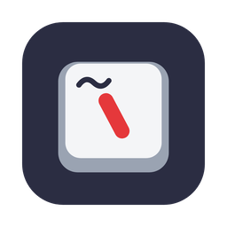
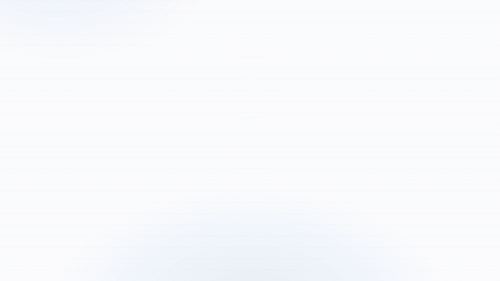

<div align="center">



# Backtickle

**The open-source Markdown reader and writer.**<br>
Write on the left, read on the right, on macOS, Windows and Linux. Free, private, and nothing in a document ever runs.

[](https://github.com/masud90/backtickle/releases/latest)
[](https://github.com/masud90/backtickle/releases/latest)
[](https://github.com/masud90/backtickle/releases/latest)

[](https://github.com/masud90/backtickle/releases/latest)
[](https://github.com/masud90/backtickle/actions/workflows/ci.yml)
[](LICENSE)
[](#contributing)
[](https://github.com/masud90/backtickle/releases)
[](https://github.com/masud90/backtickle/stargazers)
[](https://x.com/masudtweets)



</div>

## Why Backtickle

Markdown is everywhere now: READMEs, notes, papers, AI assistants' answers, and the instruction files coding
agents read. Most of the time the only way to read one properly is to open a code editor. Backtickle is a calm
desktop app that shows a Markdown file the way it is meant to be read, and lets you edit it beside the result.

- **Six flavors, detected for you.** CommonMark, GitHub Flavored Markdown, Obsidian, Pandoc / MultiMarkdown,
  Quarto / R Markdown and MDX.
- **The things technical writing needs.** Math, Mermaid and Graphviz diagrams, citations and bibliographies,
  callouts, task lists, cross-references, export to HTML, PDF and Word.
- **Safe by design.** Nothing in a document is ever executed, and the app makes no network requests of its own.
- **Light.** Built with Tauri on the system web view, not a bundled browser, so it starts fast and stays small.

## Download

Get the latest version from the [Releases page](https://github.com/masud90/backtickle/releases/latest).
One release holds every platform.

| Platform | File | Install |
| --- | --- | --- |
| **macOS** 14 Sonoma or later, Apple Silicon and Intel | `Backtickle-<version>.dmg` | Open the DMG and drag Backtickle to Applications. |
| **Windows** 10 or 11, 64-bit | `Backtickle_<version>_x64-setup.exe` (for your user) or `Backtickle_<version>_x64_en-US.msi` | Run the installer. |
| **Linux** x86-64 (Ubuntu 22.04, Debian 12, Fedora 39 or later) | `Backtickle_<version>_amd64.deb` or `Backtickle_<version>_amd64.AppImage` | `sudo apt install ./Backtickle_<version>_amd64.deb`, or `chmod +x` the AppImage and run it. |

Every file has a `.sha256` next to it on the release page if you want to check your download.

### First launch: the macOS and Windows builds are not signed yet

Backtickle is a free personal project, and code-signing certificates cost money every year (an Apple Developer
membership for macOS, a code-signing certificate for Windows). Until it has them, your system will warn you the
first time you open the app. The builds are made in public by the
[Release workflow](https://github.com/masud90/backtickle/actions/workflows/release.yml) from the source in this
repository, and you only need to allow the app once.

<details open>
<summary><b>macOS</b>: "Apple could not verify Backtickle is free of malware"</summary>

1. Open Backtickle from Applications. macOS blocks it; click **Done** (or **OK**).
2. Open **System Settings > Privacy & Security** and scroll down to the message about Backtickle.
3. Click **Open Anyway**, confirm with your password or Touch ID, then click **Open**.

Backtickle opens normally from then on. (On macOS 15 Sequoia and later, Control-click > Open no longer skips
this check, so use the steps above.)

If you prefer Terminal, removing the download quarantine flag does the same thing:

```sh
xattr -dr com.apple.quarantine /Applications/Backtickle.app
```

</details>

<details open>
<summary><b>Windows</b>: "Windows protected your PC"</summary>

1. When SmartScreen shows the blue "Windows protected your PC" window, click **More info**.
2. Click **Run anyway**.

If your browser flags the download as uncommon, choose **Keep** (in Edge: the **...** menu next to the
download, then **Keep**, then **Show more > Keep anyway**).

</details>

<details>
<summary><b>Linux</b>: nothing to bypass</summary>

Linux does not check for a publisher signature, so there is no warning to get past. The `.deb` adds Backtickle to the app menu and to
"Open With" for Markdown files; Preferences can then make it the default Markdown app. The AppImage only needs
to be made executable (`chmod +x Backtickle_<version>_amd64.AppImage`).

</details>

If you would like to help Backtickle get signed releases, see [Contributing](#contributing).

## Screenshots

<table>
  <tr>
    <td></td>
    <td></td>
  </tr>
  <tr>
    <td></td>
    <td></td>
  </tr>
</table>

## Features

**Markdown flavors**
- CommonMark, GitHub Flavored Markdown, Obsidian, Pandoc / MultiMarkdown, Quarto / R Markdown and MDX.
- The flavor is detected per document and can be overridden from the flavor pill in the title bar.
- Pandoc citations and bibliographies (BibTeX, CSL JSON, CSL YAML), Obsidian wikilinks, embeds, callouts and
  properties, Quarto cross-references, callouts and tabsets. Code chunks and MDX components are shown, never run.

**Writing**
- CodeMirror 6 editor with formatting commands, list continuation, auto-pairing, find and replace, and autocomplete.
- Smart paste: a URL over a selection becomes a link; web, Word and Outlook content becomes Markdown; Excel cells become a table.
- Paste a screenshot or drop images into the editor; they are saved next to the document and linked.
- Live Preview in Editor, snippets, typewriter scrolling, reading ruler and focus-line spotlight.
- Word, character and reading-time counts that skip Markdown syntax, code and metadata.

**Preview**
- Editor, Split and Preview views with synced scrolling and a document outline.
- Math (KaTeX), Mermaid and Graphviz diagrams, code cards, task boxes that edit the source.
- Large documents render in windows, so multi-megabyte files stay responsive.
- Exact Preview through Pandoc (optional).

**Files and search**
- Folder sidebar with rename, move, duplicate and move to Trash (nothing is deleted permanently).
- Folder search, Quick Open and a command palette.
- Changes made outside Backtickle are detected; session restore and crash recovery.

**Export**
- HTML, one-click PDF, print, Copy as HTML, Word (through Pandoc) and Render with Quarto.

**Windows and tabs**
- One window with tabs; Move Tab to New Window for several windows. Preferences is a separate window.

**Accessibility**
- Dyslexia-friendly reading, reading ruler, reduce motion, high-contrast dividers, interface scale 100 to 150%.
- Full keyboard access and editable shortcuts. The interface is checked with axe against WCAG 2.2 AA.

**Safety and privacy**
- The preview is sanitized and runs under a strict content security policy.
- The app makes no network requests of its own. Links open in your browser only when you click them, and
  remote images can be turned off in Preferences.

## Compared with other Markdown apps

Coming from another app? These pages compare Backtickle feature by feature, including where the other app is the
better choice: [Typora](https://masud90.github.io/backtickle/vs/typora/),
[Obsidian](https://masud90.github.io/backtickle/vs/obsidian/),
[MarkText](https://masud90.github.io/backtickle/vs/marktext/),
[iA Writer](https://masud90.github.io/backtickle/vs/ia-writer/),
[Zettlr](https://masud90.github.io/backtickle/vs/zettlr/),
[MacDown](https://masud90.github.io/backtickle/vs/macdown/),
[ghostwriter](https://masud90.github.io/backtickle/vs/ghostwriter/) and
[Marked](https://masud90.github.io/backtickle/vs/marked/).

## Requirements

macOS 14 Sonoma or later, with Safari 26 installed (Software Update offers it on Sonoma and Sequoia;
Backtickle draws its window with the system WebKit that Safari brings). The release DMG is universal
(Apple Silicon and Intel).

Windows 10 or 11 (64-bit) with the Microsoft Edge WebView2 Runtime, which Windows 11 has built in (the
installer adds it on Windows 10 if it is missing). The translucent sidebar needs Windows 11.

Linux on x86-64 with WebKitGTK 4.1 (Ubuntu 22.04, Debian 12, Fedora 39 or later; the .deb installs it). The
sidebar is always opaque on Linux.

## Optional tools

- **Pandoc** enables Word export and Exact Preview. Backtickle finds the Pandoc inside RStudio (on Windows and Linux also a Pandoc or Quarto install, or one on PATH), or you can choose one in Preferences.
- **RStudio and Quarto**: Render with Quarto hands the document to RStudio, where you press Render. Without RStudio, Terminal (a Command Prompt window on Windows, the system's terminal app on Linux) runs the render command.

## Contributing

Backtickle is young, and there is room to shape it. You do not need to be a Rust or Svelte expert to help;
some of the most useful contributions are not code at all. The [roadmap](ROADMAP.md) shows what is planned next,
with an issue for each item.

- **Try it and tell us what breaks.** [Open an issue](https://github.com/masud90/backtickle/issues/new) with the
  file that rendered wrong (or a small piece of it), your platform and the version. Rendering bugs with a sample
  are the easiest to fix.
- **Send Markdown that trips it up.** Real-world documents in any of the six flavors make the best test fixtures,
  especially Pandoc, Quarto and Obsidian files.
- **Package it.** Homebrew, winget, Scoop, Flatpak, the AUR or another package manager you use: help is welcome
  getting Backtickle into them.
- **Help with signing.** If you can sponsor or advise on an Apple Developer ID or a Windows code-signing
  certificate (for example through an open-source signing program), please get in touch through an issue.
- **Check accessibility.** Screen reader and keyboard-only reports on any platform are very valuable.
- **Write code.** Look for issues labeled
  [good first issue](https://github.com/masud90/backtickle/labels/good%20first%20issue) or
  [help wanted](https://github.com/masud90/backtickle/labels/help%20wanted) (packaging tasks are labeled
  [packaging](https://github.com/masud90/backtickle/labels/packaging)), or open an issue to discuss an idea before
  a large change.

Four principles guide every change: nothing in a document is ever executed, the app makes no network requests
of its own, memory use stays low, and dependencies use permissive licenses. [CONTRIBUTING.md](CONTRIBUTING.md)
explains them and lists the checks to run before a pull request. Please report security problems privately, as
described in [SECURITY.md](SECURITY.md).

## Build from source

You need Node 24 and npm, the Xcode Command Line Tools, and Rust stable installed with rustup (for the universal
build also run `rustup target add x86_64-apple-darwin`).

```sh
npm ci
npm run build:app             # release app for this Mac, copied to outputs/Backtickle.app
npm run build:app:universal   # Apple Silicon and Intel
npm run dmg                   # packs the app into a DMG in outputs/
npm run app:dev               # the app window with hot reload
npm run dev                   # the frontend alone in a browser, on a mock platform
```

On Windows you need Node 24, Rust stable (MSVC) and the Visual Studio C++ Build Tools; then `npm ci` and
`npm run build:app:windows` build the installers into `src-tauri/target/release/bundle/` (`nsis/` and `msi/`).

On Linux you need Node 24, Rust stable and the WebKitGTK development packages (on Debian and Ubuntu:
`sudo apt install libwebkit2gtk-4.1-dev libgtk-3-dev librsvg2-dev libayatana-appindicator3-dev patchelf`); then
`npm ci` and `npm run build:app:linux` build the .deb and the AppImage into `src-tauri/target/release/bundle/`
(`deb/` and `appimage/`).

## Tests

```sh
npm run check          # typecheck, lint, unit tests
npm run test:rust      # Rust tests
npm run test:ui        # Playwright on WebKit (once: npx playwright install webkit)
npm run test:fidelity  # compares output with Pandoc and Quarto fixtures
npm run test:pandoc    # needs Pandoc
node scripts/gen-large-doc.mjs --size 100k   # generates the large-document fixtures
```

Keep the screen unlocked while the UI tests run. See [CONTRIBUTING.md](CONTRIBUTING.md).

## Releasing

Set the new version in `package.json`, `src-tauri/Cargo.toml` and `src-tauri/tauri.conf.json` (the tests check
that they agree; run `npm install` and `cargo check` so the lockfiles follow), then push a matching tag (for
example `v0.2.0`). The Release workflow builds the universal app and DMG, the Windows installers and the Linux
packages, and attaches them, with their SHA-256, to a draft release that you publish by hand. To have the app
signed and notarized, add these repository secrets: `APPLE_CERTIFICATE` (base64 of the Developer ID Application
.p12), `APPLE_CERTIFICATE_PASSWORD`, `APPLE_SIGNING_IDENTITY`, `APPLE_ID`, `APPLE_PASSWORD` (an app-specific
password) and `APPLE_TEAM_ID`. Without them the app is built unsigned, as before.

One release holds every platform of a version. To add the Windows installers or the Linux packages to a
release that already has its DMG, run the Release workflow by hand with the tag, `platforms: windows` or
`platforms: linux` and, if the tag predates that build, `source: main` (the version there must match the tag).

## License and acknowledgments

Backtickle is released under the [MIT License](LICENSE). It builds on Tauri, Svelte, CodeMirror, markdown-it,
KaTeX, Mermaid, Graphviz (through @viz-js/viz) and many other open source packages; see
[THIRD_PARTY_NOTICES.md](THIRD_PARTY_NOTICES.md) for the list and licenses. Bundled fonts (Inter, JetBrains Mono,
Literata, Atkinson Hyperlegible, Lexend, OpenDyslexic) are under the SIL Open Font License 1.1.
