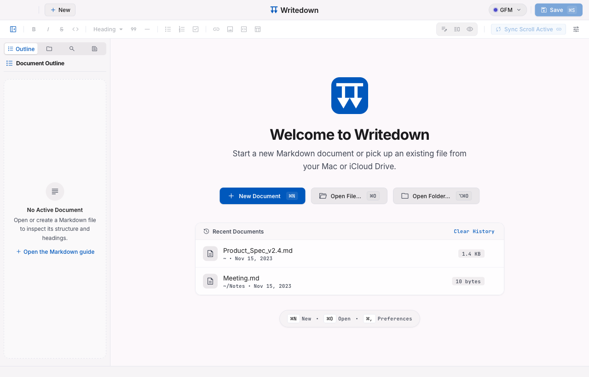
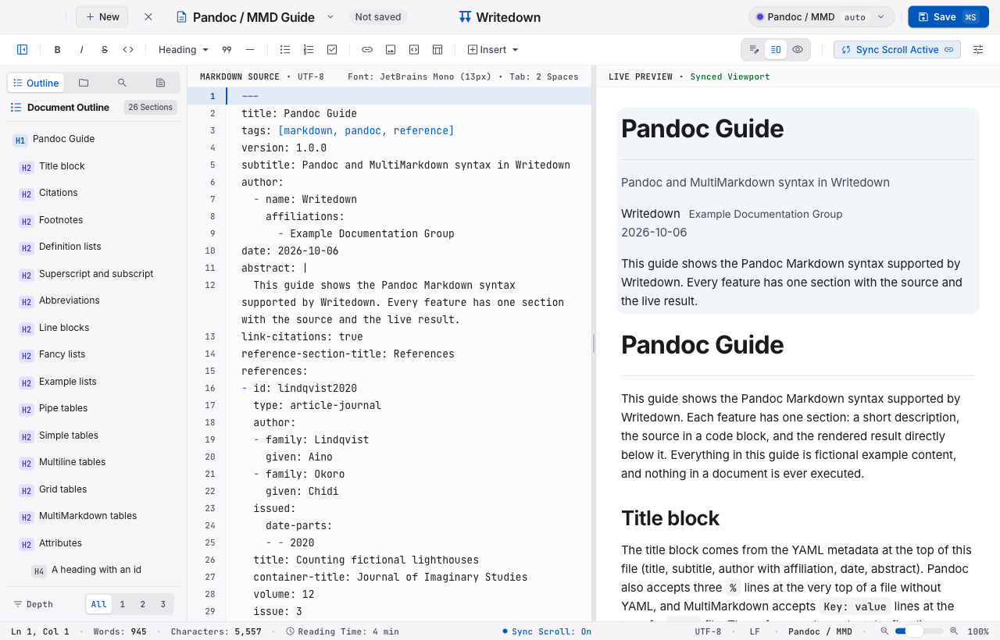
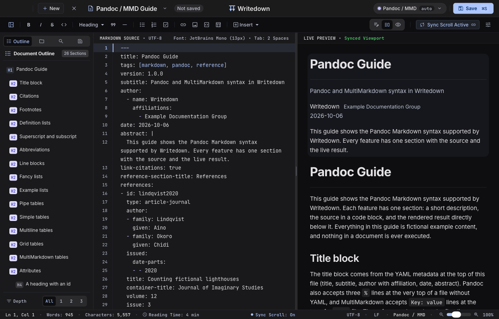
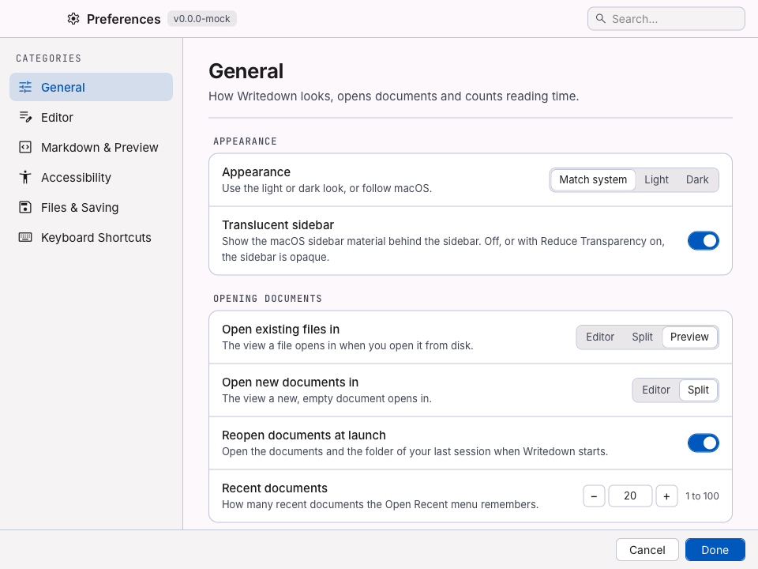

# Writedown

Writedown is a Markdown reader and writer for macOS. It shows your document as you write it, in one
window with tabs, and handles six Markdown flavors: CommonMark, GitHub Flavored Markdown, Obsidian,
Pandoc / MultiMarkdown, Quarto / R Markdown and MDX. It is built with Tauri 2, Svelte 5 and CodeMirror 6,
uses the system WebKit and aims to keep memory use low. Nothing in a document is ever executed.









## Features

**Markdown flavors**
- CommonMark, GitHub Flavored Markdown, Obsidian, Pandoc / MultiMarkdown, Quarto / R Markdown and MDX.
- The flavor is detected per document and can be overridden from the flavor pill in the title bar.
- Pandoc citations and bibliographies (BibTeX, CSL JSON, CSL YAML), Obsidian wikilinks, embeds, callouts and
  properties, Quarto cross-references, callouts and tabsets. Code chunks and MDX components are shown, never run.

**Writing**
- CodeMirror 6 editor with formatting commands, list continuation, auto-pairing, find and replace, and autocomplete.
- Smart paste: a URL over a selection becomes a link; web, Word and Outlook content becomes Markdown; Excel cells become a table.
- Snippets, typewriter scrolling, reading ruler and focus-line spotlight.
- Word, character and reading-time counts that skip Markdown syntax, code and metadata.

**Preview**
- Editor, Split and Preview views with synced scrolling and a document outline.
- Math (KaTeX), Mermaid and Graphviz diagrams, code cards, task boxes that edit the source.
- Large documents render in windows, so multi-megabyte files stay responsive.
- Exact Preview through Pandoc (optional).

**Files and search**
- Folder sidebar with rename, move, duplicate and move to Trash (nothing is deleted permanently).
- Folder search, Quick Open and a command palette.
- Changes made outside Writedown are detected; session restore and crash recovery.

**Export**
- HTML, one-click PDF, print, Copy as HTML, Word (through Pandoc) and Render with Quarto.

**Windows and tabs**
- One window with tabs; Move Tab to New Window for several windows. Preferences is a separate window.

**Accessibility**
- Dyslexia-friendly reading, reading ruler, reduce motion, high-contrast dividers, interface scale 100 to 150%.
- Full keyboard access and editable shortcuts. The interface is checked with axe against WCAG 2.2 AA.

**Safety and privacy**
- The preview is sanitized and runs under a strict content security policy.
- The app makes no network requests of its own. Links open in your browser only when you click them, and
  remote images can be turned off in Preferences.

## Install

1. Download the DMG from the [Releases](../../releases) page.
2. Open it and drag Writedown to Applications.
3. The app is not signed or notarized, because there is no paid Apple Developer ID yet. macOS therefore blocks the
   first launch. Open the app once, then go to System Settings > Privacy & Security and choose "Open Anyway".
   Alternatively, remove the quarantine flag in Terminal:

   ```sh
   xattr -dr com.apple.quarantine /Applications/Writedown.app
   ```

## Requirements

macOS 26 or later. The release DMG is universal (Apple Silicon and Intel).

## Optional tools

- **Pandoc** enables Word export and Exact Preview. Writedown finds the Pandoc inside RStudio, or you can choose one in Preferences.
- **RStudio and Quarto**: Render with Quarto hands the document to RStudio, where you press Render. Without RStudio, Terminal runs the render command.

## Build from source

You need Node 24 and npm, the Xcode Command Line Tools, and Rust stable installed with rustup (for the universal
build also run `rustup target add x86_64-apple-darwin`).

```sh
npm ci
npm run build:app             # release app for this Mac, copied to outputs/Writedown.app
npm run build:app:universal   # Apple Silicon and Intel
npm run dmg                   # packs the app into a DMG in outputs/
npm run app:dev               # the app window with hot reload
npm run dev                   # the frontend alone in a browser, on a mock platform
```

## Tests

```sh
npm run check          # typecheck, lint, unit tests
npm run test:rust      # Rust tests
npm run test:ui        # Playwright on WebKit (once: npx playwright install webkit)
npm run test:fidelity  # compares output with Pandoc and Quarto fixtures
npm run test:pandoc    # needs Pandoc
node scripts/gen-large-doc.mjs --size 100k   # generates the large-document fixtures
```

Keep the screen unlocked while the UI tests run. See [CONTRIBUTING.md](CONTRIBUTING.md).

## License and acknowledgments

Writedown is released under the [MIT License](LICENSE). It builds on Tauri, Svelte, CodeMirror, markdown-it,
KaTeX, Mermaid, Graphviz (through @viz-js/viz) and many other open source packages; see
[THIRD_PARTY_NOTICES.md](THIRD_PARTY_NOTICES.md) for the list and licenses. Bundled fonts (Inter, JetBrains Mono,
Literata, Atkinson Hyperlegible, Lexend, OpenDyslexic) are under the SIL Open Font License 1.1.
