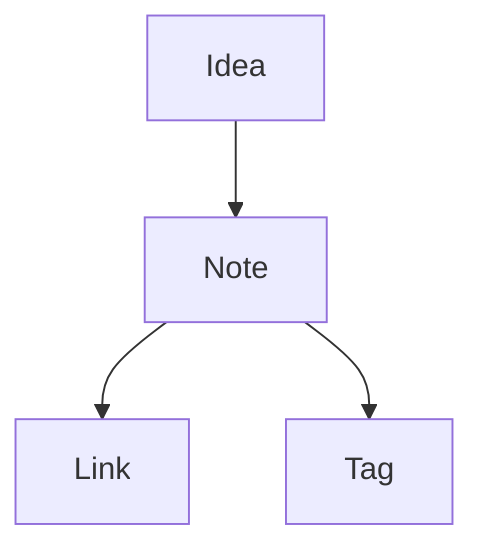

# Obsidian Guide

This guide shows the Obsidian syntax supported by Backtickle, on top of GitHub Flavored Markdown. Each feature has one section: a short description, the source in a code block, and the rendered result directly below it. The frontmatter at the top of this file is shown as a properties table, as in Obsidian.

## How links resolve in a vault

A vault is a folder that contains a `.obsidian` folder. When a note is inside a vault, Backtickle indexes the notes and attachments in it. A link such as `[[Note]]` is resolved in this order: an exact relative path (with or without `.md`), otherwise the notes with that file name, taking the one with the fewest folder steps from the current note, and ties go in alphabetical order. A click on a resolved link opens the note in a tab. A link that matches nothing is shown as unresolved. This guide is not in a vault, so every wikilink and embed below is unresolved when you open it; they show how the syntax looks, and they work once the text is in a note inside a vault.

## Wikilinks

Wikilinks use double brackets. You can add an alias after a pipe, and point at a heading or a block.

```markdown
[[Meeting notes]]
[[Meeting notes|the notes]]
[[Meeting notes#Agenda]]
[[Meeting notes#^abc123]]
[[#Highlights]] (a heading in this same note)
```

Result:

[[Meeting notes]]
[[Meeting notes|the notes]]
[[Meeting notes#Agenda]]
[[Meeting notes#^abc123]]
[[#Highlights]] (a heading in this same note)

## Embeds

An exclamation mark before a wikilink embeds the target: an image (with an optional width or width and height), a whole note, a heading section or a block. Other file types, such as PDFs, appear as a link card. These targets do not exist here, so they are unresolved.

```markdown
![[diagram.png]]
![[diagram.png|300]]
![[diagram.png|300x200]]
![[Meeting notes]]
![[Meeting notes#Agenda]]
![[Meeting notes#^abc123]]
![[report.pdf]]
```

Result:

![[diagram.png]]
![[diagram.png|300]]
![[diagram.png|300x200]]
![[Meeting notes]]
![[Meeting notes#Agenda]]
![[Meeting notes#^abc123]]
![[report.pdf]]

## Callouts

A callout is a block quote that starts with `[!type]`. Add a title after the type. A plus or minus sign right after the type makes it foldable, open (`+`) or closed (`-`). Types are not case sensitive, and an unknown type looks like a note.

```markdown
> [!note]
> A plain note.

> [!tip] A custom title
> A tip with a title.

> [!warning]+ Foldable, open
> You can fold this one.

> [!question]- Foldable, closed
> Open it to read the answer.

> [!example] Nested callouts
> The outer text.
> > [!info] Inner callout
> > The inner text.

> [!my-custom-type] Unknown type
> Styled like a note.
```

Result:

> [!note]
> A plain note.

> [!tip] A custom title
> A tip with a title.

> [!warning]+ Foldable, open
> You can fold this one.

> [!question]- Foldable, closed
> Open it to read the answer.

> [!example] Nested callouts
> The outer text.
> > [!info] Inner callout
> > The inner text.

> [!my-custom-type] Unknown type
> Styled like a note.

## Highlights

Two equals signs mark text as highlighted.

```markdown
This is ==highlighted text== in a sentence.
```

Result:

This is ==highlighted text== in a sentence.

## Comments

Text between two percent signs is a comment. It is hidden in the preview, and it can span several lines.

```markdown
Visible text. %%This inline comment is hidden.%% More visible text.

%%
This comment runs over
several lines and is hidden too.
%%
```

Result:

Visible text. %%This inline comment is hidden.%% More visible text.

%%
This comment runs over
several lines and is hidden too.
%%

## Tags

A hash followed by letters makes a tag. Tags can be nested with slashes and need at least one non-digit character. Tags in code, and a hash at the start of a heading, are not tags.

```markdown
A note about #research and #projects/alpha, but not #2026 or `#code`.
```

Result:

A note about #research and #projects/alpha, but not #2026 or `#code`.

## Block ids

Put a caret and an id at the end of a block to make it linkable with `[[Note#^id]]`. The id is hidden in the preview.

```markdown
This paragraph can be linked to from other notes. ^my-block

- A list item can have one too ^item-id
```

Result:

This paragraph can be linked to from other notes. ^my-block

- A list item can have one too ^item-id

## Properties

Properties are the YAML frontmatter at the very top of a note. Backtickle shows them as a table of keys and values, with lists and tags as small pills. This guide's own properties are at the top of the preview. The source looks like this:

````markdown
---
title: Meeting notes
tags: [work, planning]
aliases: [Weekly sync]
date: 2026-10-06
---
````

## Inline footnotes

Footnotes can be written inline with `^[...]`, or with a label as in GFM.

```markdown
A statement with an inline note.^[This note is written in place.] A statement with a labeled note.[^1]

[^1]: The labeled note is defined anywhere in the file.
```

Result:

A statement with an inline note.^[This note is written in place.] A statement with a labeled note.[^1]

[^1]: The labeled note is defined anywhere in the file.

## Math

Math uses dollar signs, one pair for inline and two for display.

```markdown
Inline: $e^{i\pi} + 1 = 0$.

$$
\int_0^1 x^2 \, dx = \frac{1}{3}
$$
```

Result:

Inline: $e^{i\pi} + 1 = 0$.

$$
\int_0^1 x^2 \, dx = \frac{1}{3}
$$

## Mermaid diagrams

A code block with the language `mermaid` draws a diagram from text.

````markdown

````

Result:


