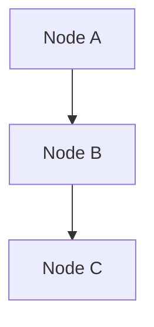

<!-- Fixture for Obsidian: wikilinks, embeds, highlights, comments, tags, callouts, block IDs, footnotes, mermaid -->

## Wikilinks

[[Plan]] (ambiguous name)

[[Projects/Plan]]

[[Note A|an alias]]

[[Note A#Second heading]]

[[Note A#^block1]]

[[#Local heading]]

[[Does Not Exist]]

## Embeds

![[diagram.png]]

![[diagram.png|300]]

![[diagram.png|300x200]]

![[Note A]]

![[Note A#Second heading]]

![[Note A#^block1]]

![[report.pdf]]

![[Cycle A]]

## Highlights and Comments

This is ==important== content.

%%This is a hidden inline comment%%

%%
This is a multi-line
hidden block comment
%%

## Tags

#review

#project/alpha

#2024 (not a tag)

`#tag` (not a tag inside inline code)

## Callout: Note

> [!note]
> This is a note callout

## Callout: Abstract

> [!abstract]
> This is an abstract

## Callout: Summary

> [!summary]
> This is a summary

## Callout: TLDR

> [!tldr]
> This is a TLDR

## Callout: Info

> [!info]
> This is an info

## Callout: Todo

> [!todo]
> This is a todo

## Callout: Tip

> [!tip]
> This is a tip

## Callout: Hint

> [!hint]
> This is a hint

## Callout: Important

> [!important]
> This is important

## Callout: Success

> [!success]
> This is a success

## Callout: Check

> [!check]
> This is a check

## Callout: Done

> [!done]
> This is done

## Callout: Question

> [!question]
> This is a question

## Callout: Help

> [!help]
> This is a help callout

## Callout: FAQ

> [!faq]
> This is an FAQ

## Callout: Warning

> [!warning]
> This is a warning

## Callout: Caution

> [!caution]
> This is a caution

## Callout: Attention

> [!attention]
> This is an attention callout

## Callout: Failure

> [!failure]
> This is a failure

## Callout: Fail

> [!fail]
> This is a fail

## Callout: Missing

> [!missing]
> This is missing

## Callout: Danger

> [!danger]
> This is a danger callout

## Callout: Error

> [!error]
> This is an error

## Callout: Bug

> [!bug]
> This is a bug

## Callout: Example

> [!example]
> This is an example

## Callout: Quote

> [!quote]
> This is a quote

## Callout: Cite

> [!cite]
> This is a cite

## Custom Callout Title

> [!note] My Custom Title
> This callout has a custom title

## Callout Fold Expanded

> [!tip]+
> This callout is expanded

## Callout Fold Collapsed

> [!warning]-
> This callout is collapsed

## Unknown Callout Type

> [!custom]
> This is an unknown type

## Uppercase Callout Type

> [!NOTE]
> This is uppercase

## Local heading

Local content here.

A paragraph ending with a block ID ^home-1

## Footnote

Inline footnote ^[inline note] in text.

## Mermaid Diagram

