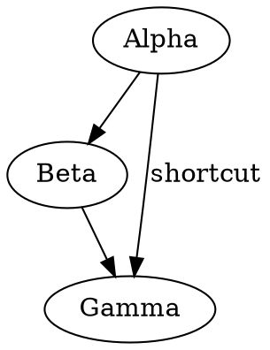
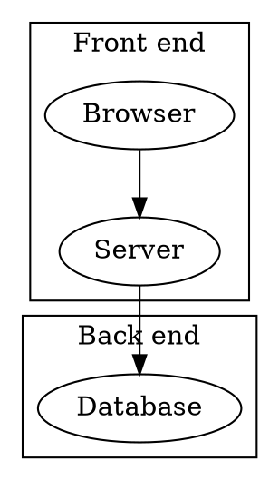

<!-- Fixture for Graphviz: a simple digraph, a cluster graph and a syntax error -->

# Graphs

## Simple



## Clusters



## Syntax error

```dot
digraph Broken {
  Alpha -> ;
  Beta [label="open
}
```
