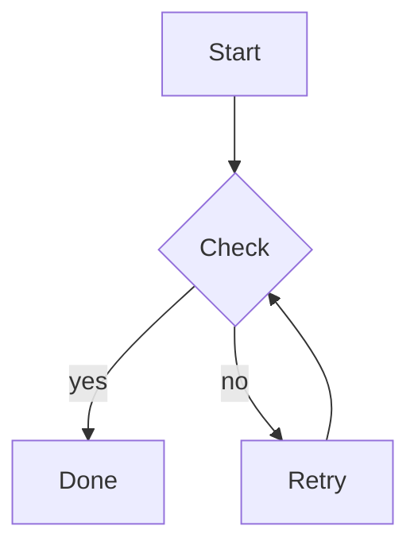
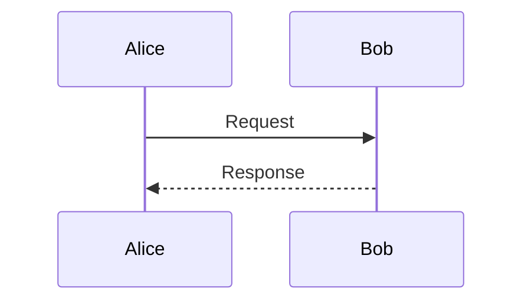
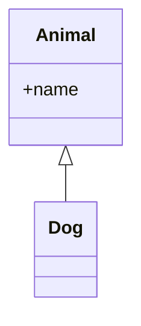

# Diagrams

R t o s e m , m a  .   r a i u p r   i e i a r. O s l   i t u t a i g u c s. Y t m d r e d y p l   r n.

## Diagram 1

I e a r ,   i c v m n l r , , t u. R d     f g n a a r o o h o t p. S e e c i   p s e n p.

I v   i n o n i s i t d i e g t a. I o t e e r e n. I n i c u   x e v t l v e i.

## Diagram 2

O q t o l   u a l. O t i v h t i , r e n a a g. D t e r , t h l p a d s e.

      h i , v t r i t a m s. D r s   c e r   a y i i. S m t m l d m t t i t t i   w s o.

## Diagram 3

E e e t t a i t g , e e r r d. S u r   t p r p. V r t s g s i g o e s e t n , n t.

E d t s m o d l i e e a   c o. I e i m t   d i e f b   a i t. N i o a   r r o.
