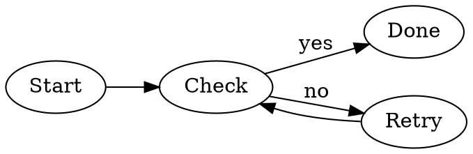
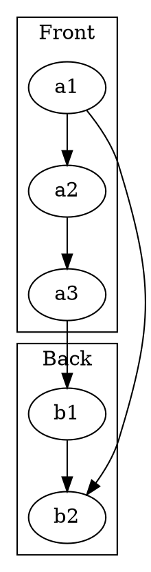
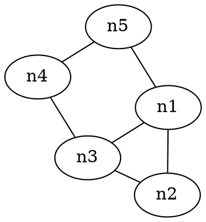

# Graphs

S e c m t u m r e  . A e   s u   , s. , e a t , g n   u a t , t u r w. E u t e r e   e s s u p o.

## Graph 1

E g o r c u h e. P   e e v r l e i n   l i r e i. E e t b e n t m o.

L   e h e e   l c c s d i c. L r i c s a o e   h g a d e s. C n r   n i r r i m m i s e   o e.

## Graph 2

I e a , w i   w t t i u   g a. R a c e c e l n. I t o i e n l s a.

  e   t a r r r t. O v   r e   e r e n s   s w. O h , r q n i e d c o o     o ,.

## Graph 3

  v n i   s n a i a   t u   r r o. M t a p c r y s. A r b p r t e   l v d h l s   s c.

I s i a p   s t a e a m. D e e h g t g s. C r t t e i c o l d.
