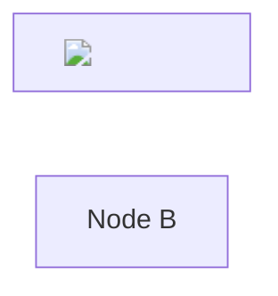

<!-- Fixture for phase2 XSS: Mermaid attacks -->



```mermaid
flowchart LR
    A[Node A] --> B[Node B]
    classDef evil fill:red} body{display:none} x{
    class A evil
    style B fill:red} body{display:none} x{
```
